<!-- 要件定義書の写し。正本は https://claude.ai/artifact/474X7tYjok4fdwbi4TgcLV 。変更したら両方を更新する -->

# 流通管理システム 再構築 要件定義書

Nov 2, 2026 · @akimasa sugai

## 1. 概要

大船渡の流通管理システム（菓子・食品の仕入・在庫・販売）を、設計から作り直す。前回の困りごとだった「動作が遅い」「改修が遅い」を、構成と設計で解消することが目的。

### 目的と前提

- 対象の業務：メーカー・生産者からの仕入、自社の保管場所での在庫管理、店舗などへの卸と請求・入金、販売先での廃棄の記録
- その会社で実際に使う本番システムとして作り直す。既存データの移行はなく、マスタもゼロから登録する
- 開発は1人、稼働時期の目安はなし。1人で保守できる構成を優先する

### 前回システムの主な問題点と方針

| 区分                 | 前回の問題                                                                                               | 再構築での方針                                                                     |
| -------------------- | -------------------------------------------------------------------------------------------------------- | ---------------------------------------------------------------------------------- |
| 業務ルールの置き場所 | 状態の判定が画面の条件分岐にあり、請求書発行日はダウンロード後に画面から受注を丸ごと更新して記録していた | ルールはサーバーのドメイン層に集める。画面は「発送する」などの操作を送るだけにする |
| API の返す値         | 状態名を日本語の文字列で返し、一覧の列名もサーバーが返していた。パラメータで値の形式が変わった           | 内部では内部コードと ISO 形式の日付だけを扱う。表示は画面の責務にする              |
| 型とテスト           | JavaScript のみで型がなく、テストもなかった。CI は lint だけ                                             | DB から画面まで型を通す。テストを CI の合格条件にする                              |
| 状態遷移             | 「戻す」操作が場当たり的に足され、受注の ID で発注の API を呼ぶ不具合もあった                            | 遷移表を先に定義し、遷移のたびに履歴を残す                                         |
| 速さ                 | API を呼ぶたびにログインのトークンを強制更新し、画面ごとにマスタを個別に取得していた                     | htmx の部分更新、起動待ちのない Workers、セッションのキャッシュ                    |
| 権限                 | ログインできれば誰でも支払処理や削除ができた                                                             | 役割と権限表を最初から設計に入れる                                                 |

### 成功の定義

- 一覧・詳細・登録などの通常操作は、1秒以内に画面が更新される
- 発送リストや一括 PDF、締め処理などの重い処理は、待ち時間を表示したうえで数十秒以内に終わる
- 項目の追加や帳票のレイアウト変更程度の改修は、自動テストで影響を確かめたうえで、その日のうちにリリースできる
- 業務ルールの変更は、ドメイン層の1か所を直せば全画面に反映される

### 対象外

取引先のログイン、会計ソフトとの連携、通販サイトや POS（ライブレジ）との自動連携、スマートフォン向けの最適化、複数社での利用。

## 2. 利用者と権限

利用者は4つの役割に分かれ、1人が複数の役割を兼任できる。閲覧・CSV 出力・集計は全員ができ、登録や変更の操作だけを役割で制限する。

| 役割           | 主な業務                                                                   |
| -------------- | -------------------------------------------------------------------------- |
| 仕入担当       | 発注書を作って仕入先に送り、入荷を確認する                                 |
| 受注・出荷担当 | 店舗などからの注文を登録し、発送リストを見て出荷する（倉庫での作業を含む） |
| 経理担当       | 仕入先への支払いと、販売先への請求・入金を管理する                         |
| 管理者         | マスタと設定の管理、社員の登録と権限の設定。すべての操作ができる           |

### 権限表

| 操作                                             | 仕入 | 受注・出荷 | 経理 | 管理者 |
| ------------------------------------------------ | ---- | ---------- | ---- | ------ |
| 社員の登録・役割変更・無効化                     |      |            |      | ○      |
| 自社情報、税率表、端数処理の設定                 |      |            |      | ○      |
| 保管場所・払い出し先店舗のマスタ                 |      |            |      | ○      |
| 商品マスタ・ジャンル                             | ○    |            |      | ○      |
| 取引先の登録・編集                               | ○    | ○          |      | ○      |
| 取引先の取引条件・登録番号の編集                 |      |            | ○    | ○      |
| 発注の作成・確定・送付・取消                     | ○    |            |      | ○      |
| 入荷確認・入荷の取消                             | ○    | ○          |      | ○      |
| 仕入返品                                         | ○    |            |      | ○      |
| 仕入先請求書の登録・支払                         |      |            | ○    | ○      |
| 受注の作成・編集・分割・取消                     |      | ○          |      | ○      |
| 発送・一括発送・発送の取消、納品書の発行         |      | ○          |      | ○      |
| 返品伝票、販売先廃棄                             |      | ○          |      | ○      |
| 請求書の発行・締め処理・取消と再発行、返還請求書 |      |            | ○    | ○      |
| 入金の記録・消込                                 |      |            | ○    | ○      |
| 在庫の調整・移動・店舗払い出し・棚卸             |      | ○          |      | ○      |
| 閲覧・CSV 出力・集計                             | ○    | ○          | ○    | ○      |

取引条件と登録番号だけを経理に分けたのは、支払予定日と請求の締めに直接効く項目だから。入荷確認は、倉庫で受け取る人が記録できるように仕入と受注・出荷の両方に許可する。操作できないボタンは画面に出さず、サーバー側でも必ず権限を判定する。

### ログインと社員の登録

- ログインは Better Auth の Google 認証。Google 側の `hd` 指定と、OAuth 同意画面を「内部」にする設定の二重で、会社の Google Workspace のドメインに限定する
- 管理者がメールアドレス・氏名・役割を先に登録し、本人の初回ログインで Google アカウント固有の ID と紐づける。以後はメールアドレスが変わっても同じ社員として扱う
- 未登録の人は、Google のログインを通ってもセッションを作らず、「利用登録がありません」と表示する
- 無効にした社員は、次の操作から使えなくなる。過去の取引の担当者名を残すため、削除はしない
- 最初の管理者は、環境変数に書いたメールアドレスで自動作成する

## 3. 機能要件

初回リリース（Must）は、仕入から支払、受注から入金までの業務を一通り含む。前回の実装を14の単位で棚卸しし、各単位の内容を以下のとおり確定した。

### 優先度の一覧

| 優先度 | 機能                                                                                                                                                                                   |
| ------ | -------------------------------------------------------------------------------------------------------------------------------------------------------------------------------------- |
| Must   | 3.1〜3.14 に記載の内容（下の Should 以下に挙げたものを除く）                                                                                                                           |
| Should | 商品の CSV 一括登録、棚卸、入荷予定数の表示、メーカー直の受注からの発注作成、販売先ごとの仕分けリスト、売上・仕入の集計画面、仕入先請求書 PDF の添付保存、倉庫向け画面のオフライン閲覧 |
| Could  | ライブレジ取込用の CSV 出力、販売先別の単価表、JAN のバーコード読み取り                                                                                                                |
| Won't  | ライブレジ用データの管理、賞味期限・ロット別の在庫、店舗の在庫管理、宅配便の送り状、粗利の集計、繰越つきの請求書、FAX 送信                                                             |

### 3.1 認証・社員・自社設定

- ログインと社員の登録は「2. 利用者と権限」のとおり
- 自社情報（名称、インボイスの登録番号、連絡先、振込先）は1件だけの設定として管理者が編集する。登録番号は「T + 13桁」の形式を検証する
- 税率表（税区分ごとの税率と適用開始日）と、消費税の端数処理の方法（初期値は切り捨て）を設定で持つ

### 3.2 商品マスタ

- 商品は「仕入単位」「販売単位」「入数」（1仕入単位あたりの販売単位の数）を持ち、在庫は販売単位で数える。販売単位は商品ごとに1つ
- 税区分（標準・軽減）は商品ごとに1つで、仕入と販売で共通。税率は取引日時点の税率表で決まる
- 仕入価格（仕入単位）と卸単価（販売単位）は税抜で、小数第2位まで持てる
- 商品コードは必須で重複不可。未定なら自動で採番する。JAN は任意で、桁数とチェックディジットを検証する。商品コードと JAN はライブレジと同じ値にそろえる運用にする
- そのほかの項目：仕入先、ジャンル、温度帯（常温・冷蔵・冷凍）、最低ロット（仕入・販売）、リードタイム（日数）、発注点管理と発注点在庫数、送料条件（仕入・販売）、「発注時に仕入価格を入力する」、備考
- 取引で使われた商品は削除できず「取扱終了」にする。初期在庫は商品の登録と切り離し、在庫調整で入れる
- 一覧は商品名・コード・JAN・ジャンル・仕入先で検索できる

### 3.3 取引先・保管場所・その他のマスタ

- 仕入先と販売先を「取引先」1つにまとめ、「仕入先」「販売先」の区分を両方つけられる
- 項目：名称、読み仮名、敷称（御中・様）、担当者名、連絡先一式（郵便番号、住所、電話、携帯、FAX、メール、LINE、主な連絡手段）、適格請求書発行事業者の登録番号（任意）、取引条件（締め日・支払日、任意）、配送日数（販売先、初期値0日）、既定の送付方法（メール・送付しない）、参考情報（通常の発注・受注方法、通販掲載可否、地名）
- 連絡先は共通の部品にし、郵便番号（7桁）・電話・FAX の形式を全マスタで同じように検証する
- 保管場所（在庫を置く場所、連絡先一式）、払い出し先店舗（名前のみ）、ジャンル（名前と表示順）を管理する
- 前回の「仕入納入先」マスタは廃止する。取引で使われたマスタは削除せず「取引終了」にする

### 3.4 在庫

- 在庫は追記のみの台帳で管理する。誤りは打ち消しの行を追加して直し、編集も削除もしない
- 「商品×保管場所」ごとの現在庫と引当数を集計表に持ち、台帳への追記と同じトランザクションで更新する
- 出荷可能数 = 現在庫 − 引当数。受注の登録で引き当て、発送で実際に減らす。メーカー直の受注は引き当てない
- 理由：入荷、発送、返品戻し、仕入返品、移動（出・入）、調整、サンプル、処分、初期在庫、棚卸差異、店舗払い出し
- 在庫操作は伝票の形で、複数の商品をまとめて記録できる。移動は移動元の減と移動先の増を同時に記録し、同じ場所への移動と0以下の数量はエラーにする
- 自社店舗の在庫は管理しない。倉庫から店舗へ出した時点で「店舗払い出し」として在庫から外す
- 発送・移動・調整で在庫がマイナスになる場合はエラーにし、足りない商品と数を表示する
- 画面：在庫一覧（商品×保管場所、CSV 出力つき）、商品ごとの在庫明細（期間・保管場所・理由で絞り込み）
- Should：棚卸（保管場所ごとに実際の数を一括入力し、差を「棚卸差異」として記録）、入荷予定数の表示

### 3.5 発注

- 発注番号を採番する（例：PO-2026-000123）。発注書は仕入先ごとに1枚で、商品はその仕入先の取扱商品に限定する
- 納入先は「保管場所」「販売先（メーカー直）」「その他の届け先（住所を入力、在庫に計上しない）」から選ぶ
- 明細は、商品、数量（仕入単位）、単価（マスタの値が初期値）、明細備考。入数と税区分を明細に複写する
- 社内担当者の初期値はログイン中の本人。支払予定日は取引条件があれば自動で計算する
- 確定（作成中 → 発注済み）と送付を1つのユースケースにまとめる。発注済み以降は明細を編集できない
- 取消は入荷前のみで、理由を記録する。前回の「アーカイブ」は廃止する
- 一覧は1画面にまとめ、状態・仕入先・期間・メモの有無でサーバー側で絞り込む。メモは状態に関係なく編集できる

### 3.6 入荷

- 入荷確認は複数回に分けて記録できる（分納）。明細ごとに残りの数を表示し、全数がそろうか「残りは打ち切り」で入荷済みになる
- 明細ごとに「受入数」と「返品数（その場で返したもの）」を分けて入力する。在庫に入るのは「受入数 × 入数」
- 保管場所は発注の納入先から自動で決まる。入荷日の初期値は当日
- メーカー直とその他の届け先の発注は、「納品済み」の確認だけで在庫を動かさない
- 入荷の誤りは、支払済みになる前なら取り消せる（在庫は打ち消しの行で戻す）
- 入荷後に見つかった不良品は仕入返品として記録し、在庫から減らす
- 入荷予定一覧を新設する。発注済みで未入荷の明細を、納品希望日の順に保管場所ごとに表示する

### 3.7 仕入先請求書と支払

- 仕入先の請求書を独立したデータとして登録し、1枚の請求書に1件以上の入荷を結びつける。項目は請求書番号、請求日、請求額、送料
- 登録画面は仕入先を起点にする。締め日を設定した仕入先は締め期間内の入荷をチェック済みで、設定していない仕入先はチェックなしで開く。発注・入荷の詳細画面からも開ける
- システムの計算額（受入数 × 単価 + 送料 − 仕入返品）と請求額の差額を、チェックのたびにその場で表示する。差額があっても理由を入力すれば登録できる
- 支払時には支払日と支払額を記録する。取消には理由を残す
- 一括支払いは、絞り込んだ請求書をチェックで選び、サーバー側の1つのトランザクションで処理して結果を表示する
- 支払予定一覧（未払いの合計つき）と、仕入先別・月別の買掛残高を CSV でも出力できる
- Should：受け取った請求書の PDF を添付して保存する（電子帳簿保存法の対象）

### 3.8 受注

- 受注番号を採番する（例：SO-2026-000123）。受注一覧を新設し、状態・販売先・出荷予定日・保管場所で絞り込む
- 商品の選択は発注と共通のダイアログ。コード・名前・JAN で検索でき、複数の商品をまとめて追加できる
- 明細の追加や数量の変更では、変わった行と合計欄だけをサーバーで計算して差し替える
- 単価は商品の卸単価が初期値で、例外だけ明細で修正できる（理由を残す）。明細には受注時点の単価と税区分を複写する
- 明細ごとに出荷可能数を表示し、超える数量、最低ロット未満、ロットの倍数でない数量は警告する（登録はできる）
- 出荷予定日を持ち、初期値は「納品希望日 − 販売先の配送日数」。受注ごとに変更できる
- 送料は受注時に入力する（税区分の初期値は標準税率）
- 発送前は編集でき、引当も更新する。取消は発送前のみで理由を記録する。一部だけ先に発送する場合は受注を分割する
- Should：メーカー直の受注から、仕入先ごとに発注を自動作成する（納入先はその販売先。受注と発注を結びつけて表示）

### 3.9 発送

- 発送リスト：出荷予定日×保管場所で、行が商品、列が販売先、右端が合計の表。列は販売先の ID で管理し、その日に受注がある販売先だけを出す
- 印刷はサーバーが印刷用の HTML を返す。A4 横が基本で、販売先が多いときは列を分けて複数ページにする
- 一括発送は、対象の受注をチェックつき（初期は全選択）で表示してから実行する。1つのトランザクションで処理し、在庫が足りない受注は示したうえで「外して続ける」か「中止」を選べる
- 個別の発送は受注の詳細画面から行う
- 納品書・請求書の一括 PDF は非同期で生成し、進み具合を表示して、完了したらダウンロードできる
- 入金前なら発送を取り消せる（理由を記録し、在庫を打ち消しで戻し、引当も戻す）
- Should：販売先ごとの仕分けリスト（1販売先1枚）

### 3.10 請求書・納品書

- 1枚の請求書に1件以上の発送を結びつける。販売先に締め日を設定すれば月締め、設定しなければ発送ごとに発行する
- 月締めの販売先は「締め処理」で、締め期間内の未請求の発送をまとめて一括発行する。繰越は載せず、締め期間内の取引だけを請求する
- 請求書は「発行」で確定させる。明細・金額・宛名・自社情報を保存し、PDF も R2 に保存する。再ダウンロードでは保存済みの PDF を返す
- 発行後の変更は取消と再発行で行い、履歴を残す。請求書番号と納品書番号を採番する
- インボイス制度の記載事項を満たす：発行者の名称と登録番号、取引年月日、取引内容（軽減税率の対象である旨を含む）、税率ごとの合計額と適用税率、税率ごとの消費税額、宛名
- 消費税の端数処理は請求書1枚ごとに税率ごとに1回。明細の金額（単価 × 数量）の1円未満は明細ごとに同じ方法で処理する
- 納品書は発送ごとに発行する。発行日は発行の操作で決める（初期値は当日、月締めなら締め日）
- 帳票は Hono の JSX で HTML を作り、Browser Rendering で PDF にする

### 3.11 返品・入金（売掛）

- 受注の状態は「受注済み → 発送済み」と「取消」まで。請求と入金の状態は請求書の側で持つ（未入金・一部入金・入金済み）
- 返品伝票は発送後なら何回でも記録できる。明細ごとに返品数と、在庫に戻すか廃棄かを選ぶ
- 返品伝票は金額（マイナス）を持つ。未請求の返品は次の請求書にマイナスの明細として載せ、請求済みの返品は返還請求書として発行できる（税込1万円未満は発行を任意にする）
- 入金は独立したデータ（入金日、入金額、方法、メモ）として記録し、請求書に消し込む。1件の入金を複数の請求書に、1枚の請求書に複数の入金を当てられる
- 消し込みの差額は「振込手数料」「値引き」「その他」として処理できる
- 販売先ごとの売掛残高と、入金予定一覧（支払期限の順、期限超過を強調）を表示し、CSV で出力できる

### 3.12 販売先廃棄

- 記録と分析のためだけに使い、請求・入金・自社の在庫には影響させない
- 廃棄伝票で、1つの販売先・廃棄日に対して複数の商品を登録できる。その販売先に出荷したことのある商品を先に表示する
- 廃棄理由（賞味期限切れ・破損・その他）を任意で選べる
- 集計画面では、期間・販売先・商品ごとに、廃棄数と出荷数に対する廃棄率を表示し、CSV で出力できる

### 3.13 ダッシュボード・CSV・集計

- ダッシュボードは役割ごとに「今日やること」を表示し、各項目から絞り込み済みの一覧に移れる
- 仕入：発注点割れの商品、作成中のままの発注、送付に失敗した発注書、入荷予定日を過ぎた未入荷の発注
- 受注・出荷：今日の出荷予定（保管場所別の件数）、出荷可能数が足りない受注、今日の入荷予定
- 経理：今週の支払予定、支払期限を過ぎた請求書、送付に失敗した請求書、締め処理待ちの販売先。管理者はすべて
- 発注点割れは「出荷可能数 + 入荷予定数 < 発注点在庫数」で判定し、二重発注を防ぐ
- CSV は BOM 付きの UTF-8（Excel でそのまま開ける）で、一覧の絞り込み条件と同じ内容を日本語の列名で出力する。件数が多い場合は非同期で生成する
- Should：月別の売上・仕入を、販売先別・仕入先別・商品別で表示する集計画面

### 3.14 帳票の送付

- 発注書・納品書・請求書・返還請求書をシステムから送る方法はメールのみ（PDF を添付）。取引先の既定の送付方法で送り、送る直前に変えられる
- 送付は非同期で行い、送付履歴（日時・方法・宛先・結果）を残す。失敗したら画面とダッシュボードに表示し、再送できる
- FAX でしか受け取れない取引先には、PDF をダウンロードして社内の FAX 機で送る。その場合は「手動で送付した」を履歴に記録できる

## 4. 業務の流れと状態遷移

状態を持つのは発注・受注・仕入先請求書・請求書の4つで、遷移は下の図と表にあるものだけを許す。遷移はすべてドメイン層の関数で判定し、遷移のたびに操作履歴を残す。

### 業務の全体像

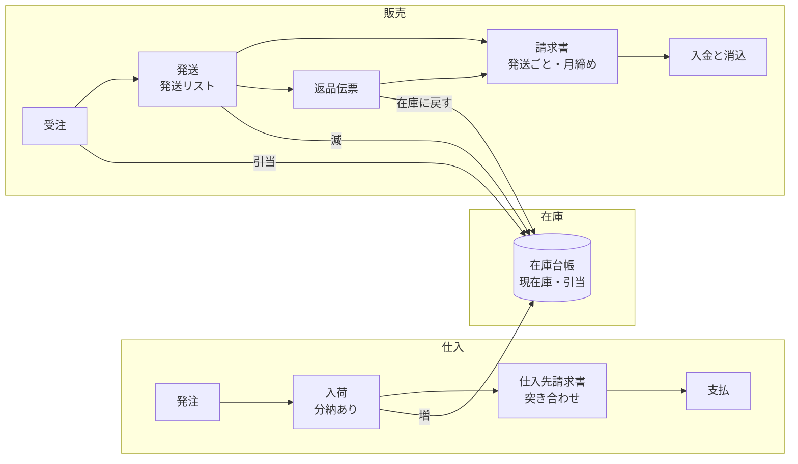

### 発注の状態遷移

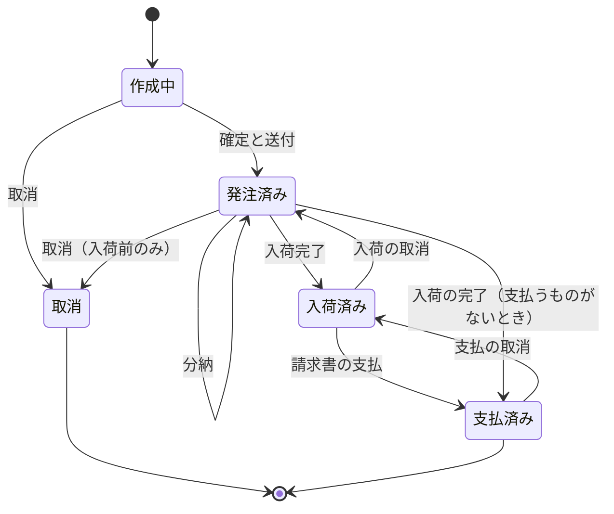

### 受注の状態遷移

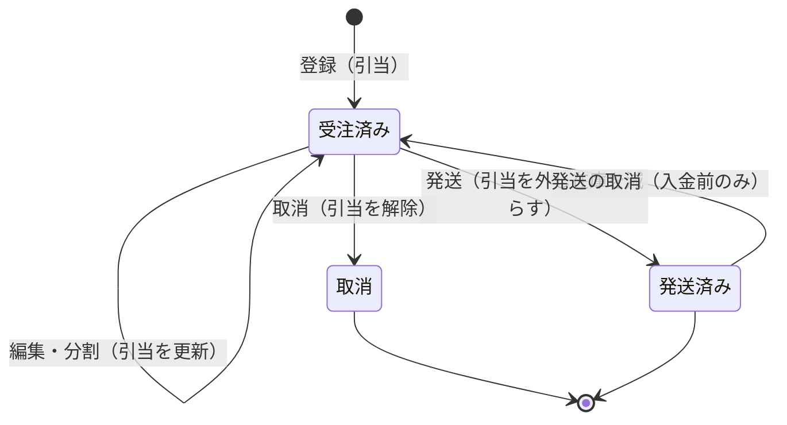

### 請求書の状態遷移

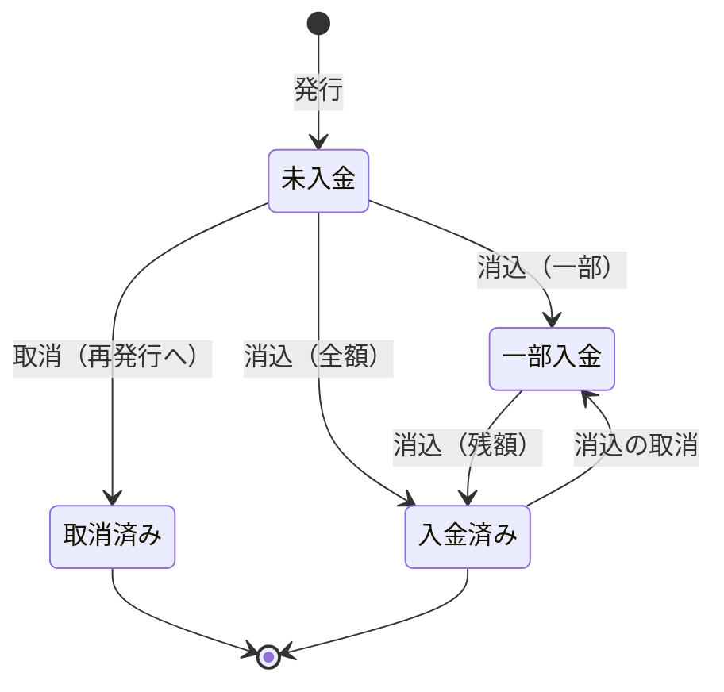

### 遷移の条件と副作用

| 対象   | 遷移              | 条件                                                                                                                                                             | 在庫・引当への影響                                                              |
| ------ | ----------------- | ---------------------------------------------------------------------------------------------------------------------------------------------------------------- | ------------------------------------------------------------------------------- |
| 発注   | 作成中 → 発注済み | 明細が1行以上。送付方法がメールなら宛先がある                                                                                                                    | なし（入荷予定数に加わる）                                                      |
| 発注   | 入荷の記録        | 発注済み。受入数 + 返品数 ≤ 残りの数                                                                                                                             | 保管場所の在庫が「受入数 × 入数」増える（メーカー直・その他の届け先は変化なし） |
| 発注   | 入荷の取消        | 対象の入荷が、支払（一部を含む）を記録した請求書に含まれていない。入荷日は発注日より前にできない                                                                 | 打ち消しの行で在庫を戻す（マイナスになるならエラー）                            |
| 発注   | 取消              | 入荷が1件もない。理由が必須                                                                                                                                      | なし                                                                            |
| 受注   | 登録・編集        | 受注済み                                                                                                                                                         | 引当数を更新。出荷可能数を超えても警告のみ                                      |
| 受注   | 発送              | 受注済み。保管場所の在庫が足りる。発送日は受注日より前にできない                                                                                                 | 引当を外し、在庫を減らす                                                        |
| 受注   | 発送の取消        | 請求書が未発行か取消済み（発行済みなら先に請求書を取り消す。消込のある請求書は取り消せないため、実質的に入金前のみ）。取り消していない返品伝票がない。理由が必須 | 在庫を打ち消しで戻し、引当も戻す                                                |
| 受注   | 取消              | 受注済み。理由が必須                                                                                                                                             | 引当を解除                                                                      |
| 請求書 | 発行              | 対象の発送が未請求                                                                                                                                               | なし（未請求の返品伝票もマイナスの明細として載せる）                            |
| 請求書 | 取消              | 消込がない。理由が必須                                                                                                                                           | なし（対象の発送は未請求に戻る）                                                |

仕入先請求書は「未払い → 一部支払 → 支払済み」と取消を持ち、受入のある入荷がすべて支払済みの請求書に入ると、対象の発注が支払済みになる（11.1）。

## 5. 画面一覧と画面遷移図

画面は約30で、ログイン後の最初の画面は役割別のダッシュボード。PC が基本で、倉庫の4画面だけタブレット（横向き）でも操作しやすくする。URL は実装時の案。

### 画面一覧

| 区分   | 画面                       | URL（案）                    | 主な内容                                                       | タブレット |
| ------ | -------------------------- | ---------------------------- | -------------------------------------------------------------- | ---------- |
| 共通   | ログイン                   | `/login`                     | 「Google でログイン」のみ                                      |            |
| 共通   | 利用登録なし               | `/no-access`                 | 未登録・無効の人に表示                                         |            |
| 共通   | ダッシュボード             | `/`                          | 役割別の「今日やること」                                       |            |
| 共通   | 処理状況                   | `/jobs`                      | 一括 PDF・大きな CSV の進み具合とダウンロード                  |            |
| 仕入   | 発注一覧                   | `/purchase-orders`           | 状態・仕入先・期間・メモの有無で絞り込む                       |            |
| 仕入   | 発注の作成・編集           | `/purchase-orders/new`       | 商品選択ダイアログつき                                         |            |
| 仕入   | 発注詳細                   | `/purchase-orders/:id`       | 確定と送付、送付履歴、入荷の記録、仕入返品、取消               |            |
| 仕入   | 入荷予定一覧               | `/receiving`                 | 保管場所別、納品希望日の順                                     | 対応       |
| 仕入   | 入荷確認                   | `/receiving/:poId`           | 明細ごとの受入数と返品数                                       | 対応       |
| 仕入   | 仕入先請求書の登録         | `/supplier-invoices/new`     | 仕入先を起点にした突き合わせ                                   |            |
| 仕入   | 支払予定一覧               | `/payables`                  | 一括支払い、買掛残高                                           |            |
| 販売   | 受注一覧                   | `/sales-orders`              | 状態・販売先・出荷予定日・保管場所で絞り込む                   |            |
| 販売   | 受注の作成・編集           | `/sales-orders/new`          | 商品選択ダイアログは発注と共通                                 |            |
| 販売   | 受注詳細                   | `/sales-orders/:id`          | 発送、分割、取消、返品伝票、納品書                             |            |
| 販売   | 発送リスト                 | `/shipping`                  | 出荷予定日×保管場所。印刷、一括発送、一括 PDF                  | 対応       |
| 販売   | 請求書一覧・詳細           | `/invoices`、`/invoices/:id` | 発行、PDF、送付履歴、取消と再発行、消込の状況                  |            |
| 販売   | 締め処理                   | `/invoices/closing`          | 月締めの販売先の請求書を一括発行                               |            |
| 販売   | 入金の登録・消込           | `/receipts/new`              | 入金を記録し、請求書に消し込む                                 |            |
| 販売   | 売掛残高・入金予定         | `/receivables`               | 支払期限を過ぎたものを強調                                     |            |
| 販売   | 販売先廃棄                 | `/disposals`                 | 廃棄伝票の一覧・登録と、廃棄率の集計                           |            |
| 在庫   | 在庫一覧                   | `/stock`                     | 商品×保管場所の現在庫、引当、出荷可能数                        |            |
| 在庫   | 在庫明細                   | `/stock/:itemId`             | 商品ごとの台帳                                                 |            |
| 在庫   | 在庫操作                   | `/stock/operations/new`      | 調整、移動、店舗払い出し                                       | 対応       |
| 在庫   | 棚卸（Should）             | `/stock/stocktaking`         | 保管場所ごとに実際の数を一括入力                               |            |
| マスタ | 商品                       | `/items`                     | 一覧・登録・編集                                               |            |
| マスタ | 取引先                     | `/partners`                  | 一覧・登録・編集                                               |            |
| マスタ | その他のマスタ             | `/masters/*`                 | 保管場所、払い出し先店舗、ジャンル                             |            |
| 管理   | 社員管理                   | `/admin/employees`           | 管理者だけに表示                                               |            |
| 管理   | 設定                       | `/admin/settings`            | 自社情報、税率表、端数処理。管理者だけに表示                   |            |
| 管理   | 帳票の検索                 | `/documents`                 | 発行済み帳票を取引年月日・金額・取引先で検索（電子帳簿保存法） |            |
| 集計   | 売上・仕入の集計（Should） | `/reports`                   | 月別に、販売先別・仕入先別・商品別で表示                       |            |
| マスタ | 商品の CSV 一括登録        | `/items/import`              | 確かめてから一括で登録・更新（11.4）                           |            |
| 販売   | 返品伝票                   | `/sales-returns/:id`         | 受注詳細から登録。取消、返還請求書の発行                       |            |
| 管理   | 操作履歴の検索             | `/audit-logs`                | 管理者だけ。期間・社員・対象・操作で絞り込む                   |            |
| 管理   | 特定時点への復元           | `/admin/restore`             | 管理者だけ。業務 DB を30日以内の時点に戻す（11.6）             |            |

### 画面遷移図

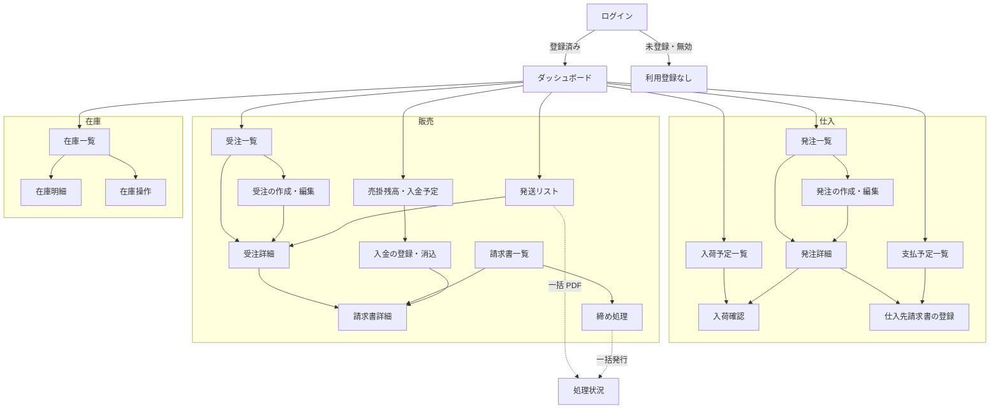

マスタ・管理・集計の画面は、左のメニューからそれぞれの一覧に直接移る（図では省略）。

### 遷移のルール

- 左のメニューは業務の区分（仕入・販売・在庫・マスタ・管理・集計）でまとめ、管理者専用の画面以外は全員に表示する。操作できないボタンは役割に応じて出さない
- 一覧から詳細へは通常のページ遷移（URL が変わり「戻る」が効く）。絞り込みは htmx で表の部分だけを差し替え、条件を URL に残す
- 詳細画面での状態の変更は、その場で該当部分だけを更新し、別の画面には移らない
- 影響の大きい操作（一括発送、締め処理、請求書の取消など）は、対象と件数を示す確認ダイアログを出してから実行する
- ダッシュボードの各項目は、絞り込み済みの一覧につながる

### タブレット対応（倉庫の4画面）

- タブレットを横向きにした幅を基準に、タッチで押しやすい大きさのボタンと入力欄にする。数量は「−」「＋」ボタンでも増減できる
- ホバーでしか現れない操作は使わない。発送リストは商品名の列を固定して横にスクロールする
- 共有タブレットに備え、ログアウトをすぐ押せる位置に置く
- 通信が途切れる場合の対策は「7. 非機能要件」を参照

## 6. データモデル

業務データは Durable Objects の SQLite に、ログイン情報は D1 に、帳票 PDF・CSV・バックアップは R2 に置く。在庫は追記のみの台帳と集計表で、金額はすべて整数で持つ。

### 全テーブル共通のルール

- 内部の ID は ULID。画面や帳票に出す番号は種別×年ごとの連番で採番する（例：PO-2026-000123、年が変わると1から）。採番テーブルは伝票の作成と同じトランザクションで更新する
- 全テーブルに作成・更新の日時と操作者、版番号を持たせる。古い画面からの保存（版番号の不一致）はエラーにする
- 日時は UTC で保存して日本時間で表示する。発注日や入荷日などの業務日は、日本時間の日付（YYYY-MM-DD）で保存する
- 単価は税抜で、100分の1円単位の整数で持つ。金額は円単位の整数で持つ。明細の金額は「単価 × 数量」の1円未満を、消費税と同じ端数処理の設定で明細ごとに処理する
- 削除は原則として行わず、取扱終了・取引終了・取消で表す
- 登録や状態を変える操作には受付番号（冪等キー）をつけ、処理済みの受付番号を保存して二重処理を防ぐ
- PLU コードは廃止。温度帯は常温・冷蔵・冷凍の固定値

### マスタ・在庫・仕入のテーブル

| テーブル                                  | 内容                               | 主な項目                                                                                                                                    |
| ----------------------------------------- | ---------------------------------- | ------------------------------------------------------------------------------------------------------------------------------------------- |
| `employees`                               | 社員                               | Better Auth のユーザー ID（初回ログインで紐づけ）、メール、氏名、役割（複数）、有効・無効                                                   |
| `partners`                                | 取引先                             | 名称、読み仮名、敷称、仕入先・販売先の区分、連絡先一式、登録番号、締め日・支払日、配送日数、既定の送付方法、参考情報、取引終了              |
| `items`                                   | 商品                               | コード、JAN、名称、仕入先、ジャンル、温度帯、税区分、仕入単位・販売単位・入数、仕入価格・卸単価、最低ロット、リードタイム、発注点、取扱終了 |
| `genres`、`locations`、`stores`           | ジャンル、保管場所、払い出し先店舗 | 名称、表示順。保管場所は連絡先一式                                                                                                          |
| `stock_ledger`                            | 在庫台帳（追記のみ）               | 日時、商品、保管場所、増減数、理由、発生元の種別と ID、打ち消し対象                                                                         |
| `stock_balances`                          | 在庫の集計表                       | 商品×保管場所ごとの現在庫と引当数                                                                                                           |
| `stock_operations`                        | 在庫操作伝票                       | 種別（調整・移動・店舗払い出し・棚卸）、日付、払い出し先店舗、明細                                                                          |
| `purchase_orders`、`purchase_order_lines` | 発注、発注明細                     | 番号、仕入先、状態、納入先（保管場所・販売先・その他の住所）、支払予定日。明細は数量・単価・入数と税区分の写し・打ち切り                    |
| `receipts`、`receipt_lines`               | 入荷（分納で複数回）               | 入荷日、保管場所、明細ごとの受入数と返品数、対象の仕入先請求書                                                                              |
| `purchase_returns`                        | 仕入返品                           | 仕入先、日付、明細、対象の仕入先請求書                                                                                                      |
| `supplier_invoices`                       | 仕入先請求書                       | 請求書番号、請求日、請求額、送料、差額と理由、支払予定日、状態、添付 PDF（Should）                                                          |
| `supplier_payments`                       | 支払                               | 請求書、支払日、支払額                                                                                                                      |

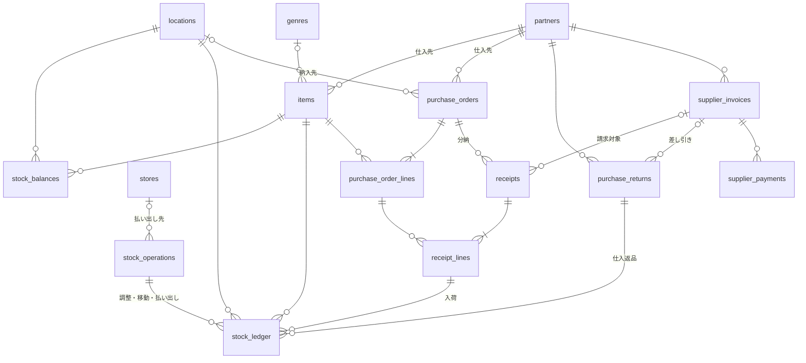

### 販売のテーブル

| テーブル                              | 内容                             | 主な項目                                                                                                                                 |
| ------------------------------------- | -------------------------------- | ---------------------------------------------------------------------------------------------------------------------------------------- |
| `sales_orders`、`sales_order_lines`   | 受注、受注明細                   | 番号、販売先、状態、保管場所またはメーカー直、納品希望日、出荷予定日、分割元、対応する発注。明細は数量・単価・税区分・単価を修正した理由 |
| `sales_charges`                       | 受注の送料                       | 金額、数量、税区分、備考                                                                                                                 |
| `shipments`                           | 発送（受注1件に有効なものは1件） | 発送日、納品書番号、取消、対象の請求書                                                                                                   |
| `invoices`、`invoice_lines`           | 請求書、発行時の明細の写し       | 番号、販売先、発行日、締め期間、支払期限、税率ごとの合計と消費税額、PDF の保存先、状態、取消・再発行の関係                               |
| `sales_returns`、`sales_return_lines` | 返品伝票                         | 返品日、明細ごとの返品数・在庫に戻すか・金額、載せた請求書、返還請求書の番号                                                             |
| `customer_payments`                   | 入金                             | 販売先、入金日、入金額、方法、メモ                                                                                                       |
| `payment_allocations`                 | 消込                             | 入金、請求書、金額、差額の区分（振込手数料・値引き・その他）                                                                             |
| `disposals`、`disposal_lines`         | 販売先廃棄                       | 販売先、廃棄日、明細ごとの商品・数量・理由                                                                                               |

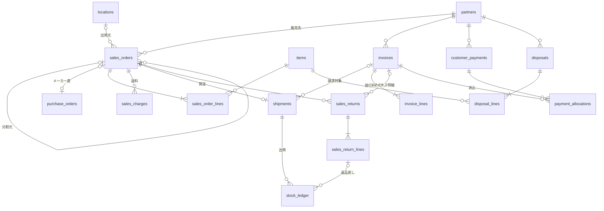

### 共通の仕組みとログイン情報

| 保存先          | テーブル・ファイル     | 内容                                                                                                 |
| --------------- | ---------------------- | ---------------------------------------------------------------------------------------------------- |
| Durable Objects | `company_settings`     | 自社情報（名称、登録番号、連絡先、振込先）、端数処理の方法                                           |
| Durable Objects | `tax_rates`            | 税区分ごとの税率と適用開始日                                                                         |
| Durable Objects | `sequences`            | 採番（種別×年ごとの次の番号）                                                                        |
| Durable Objects | `idempotency_keys`     | 処理済みの受付番号とその結果                                                                         |
| Durable Objects | `document_sends`       | 送付履歴（帳票の種類、方法、宛先、結果、手動送付の記録）                                             |
| Durable Objects | `documents`            | 発行済み帳票の索引（種類、番号、取引年月日、取引金額、取引先、R2 の保存先）                          |
| Durable Objects | `jobs`                 | 一括 PDF・大きな CSV の処理状況と R2 の保存先                                                        |
| Durable Objects | `audit_logs`           | 操作履歴（誰が・いつ・何を・変更前後の値）                                                           |
| D1              | Better Auth のテーブル | ユーザー、セッション、連携アカウント、検証用トークン。`employees` とはユーザー ID で結びつける       |
| R2              | ファイル               | 発行済み帳票の PDF（バケットロックで7年保持）、CSV、毎日のバックアップ、仕入先請求書の添付（Should） |

## 7. 非機能要件

インフラは Cloudflare に集約し、固定費は Workers 有料プランの月5ドルのみ。使っていない時間の従量課金は発生しない。

### インフラ構成

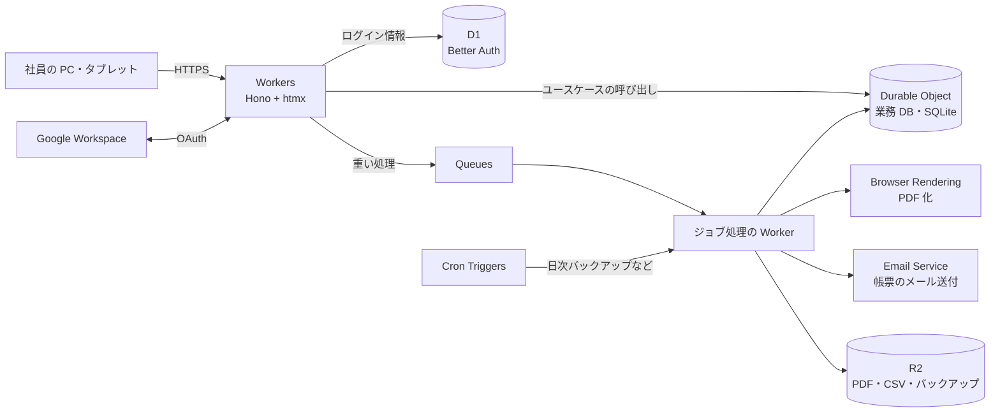

| 役割                                         | サービス                                               |
| -------------------------------------------- | ------------------------------------------------------ |
| 画面と API（Hono + htmx、同一ドメイン）      | Workers                                                |
| 業務 DB                                      | Durable Objects（SQLite）。1つのオブジェクトにまとめる |
| ログイン情報                                 | D1（Better Auth）                                      |
| 帳票 PDF・CSV・バックアップ                  | R2                                                     |
| 一括 PDF・大きな CSV・メール送付の非同期処理 | Queues                                                 |
| 帳票の PDF 化                                | Browser Rendering                                      |
| 帳票のメール送付                             | Email Service（予備は Resend）                         |
| 日次バックアップなどの定期処理               | Cron Triggers                                          |

データの国内保管の決まりはない。Durable Objects・D1・R2 は「アジア太平洋」の配置を指定する（日本国内は保証されない）。本番と検証の環境は同じアカウント内に分けて作る。

### 規模と性能

| 項目     | 想定              | テストデータ（約5倍） |
| -------- | ----------------- | --------------------- |
| 利用者   | 10人（同時に5人） | —                     |
| 受注     | 1日30件           | 3年分、約11万件       |
| 発注     | 1日10件           | 3年分、約4万件        |
| 商品     | 500点             | 2,500点               |
| 取引先   | 200社             | 1,000社               |
| 帳票 PDF | 1日約70枚         | —                     |
| メール   | 月2,000通前後     | —                     |

- 通常操作は画面の更新まで1秒以内。重い処理は非同期にして進み具合を表示し、数十秒以内に終える
- 業務 DB は1つの Durable Object で処理を順番に実行する。集計はインデックスを前提に設計し、上のテストデータで速度を確かめる
- 使用量は有料プランに含まれる量に収まる見込み：リクエストは月1,000万件の1%未満、PDF 化は月1〜2時間（含まれるのは月10時間）、メールは月3,000通の内数

### 可用性とバックアップ

- Durable Objects の特定時点への復元（30日）と、D1 の Time Travel（30日）を使う
- 毎日、業務データ全体を R2 に書き出す。直近30日分は毎日の分を、それより前は月初の分を7年間残す
- 復元の手順を手順書にまとめ、検証環境で定期的に復元を試す
- 定期処理（日次バックアップ、締め処理など）の成否は、管理者のダッシュボードに表示する
- 稼働率の SLA は定めない（社内の業務時間に使えればよい）

### セキュリティ

- ログインは会社の Google Workspace のアカウントに限定し、管理者が登録した社員だけが使える
- 権限は画面の出し分けだけでなく、ユースケースの中で毎回判定する。無効化は次の操作から即座に効く
- セッションの Cookie は Secure・HttpOnly・SameSite=Lax。画面からの POST は Hono の CSRF 対策（Origin の検証）を通す
- 入力は境界でスキーマ検証し、画面は JSX の自動エスケープを使う。生の HTML の埋め込みは禁止する
- R2 のファイルは公開せず、権限を確かめた Worker 経由でだけダウンロードさせる
- 秘密情報は Workers の Secrets に置き、リポジトリには含めない（前回は README に管理者のパスワードが書かれていた）
- 操作履歴：状態を変える操作はすべて、誰が・いつ・何を・変更前後の値を記録し、管理者が検索できる

### 電子帳簿保存法

- 発行・送付した帳票（発注書・納品書・請求書・返還請求書）の PDF を R2 に7年間保存する
- R2 のバケットロックで、保存期間中の上書きと削除を防ぐ
- 取引年月日・取引金額・取引先で、範囲指定と組み合わせによる検索ができる。取消と再発行の履歴を残す
- バケットロックのルールは設定を変更できる権限があれば外せるため、真実性の要件は事務処理規程と組み合わせて満たす。方法は税理士に確認する
- Should：仕入先からメールで受け取った請求書の PDF も同じ条件で保存する

### 帳票のメール送付

- Cloudflare Email Service を使う（2026年4月に公開ベータ）。有料プランに月3,000通が含まれ、添付を含めて1通25MiBまで
- 新しいアカウントは1日の送信数が少なめに設定され、実績に応じて上がるため、稼働前の検証期間から送信しておく
- 送信元は会社のドメインにし、SPF・DKIM・DMARC を設定する
- 送信部分は差し替えられる作りにし、ベータで問題が出たら Resend に切り替える

### 倉庫の通信（Wi-Fi が途切れる前提）

- 登録や状態を変える操作には、操作ごとに固有の受付番号をつける。同じ番号が2回届いても1回分しか処理しない
- 通信が途切れたら画面の上部に表示する。送信に失敗しても入力内容は消さず、同じ受付番号で再送信できる
- 倉庫の4画面は、入力途中の内容をタブレットに一時保存し、開き直しても続きから入力できる。一時保存はログアウトで消す
- Should：発送リストと入荷予定一覧は、最後に読み込んだ内容をオフラインでも閲覧できる（読み込んだ時刻を表示）

### エラーの記録と通知

- エラーは Workers のログに、検索しやすい構造化した形式で出力する
- 重大なエラーは管理者にメールで通知する（同じエラーは1時間に1回まで）

### 費用の見込み

| 項目                                                                                                   | 月額                                                        |
| ------------------------------------------------------------------------------------------------------ | ----------------------------------------------------------- |
| Workers 有料プラン（Durable Objects・D1・Queues・Browser Rendering・Email Service の含まれる量を含む） | 5ドル                                                       |
| R2（PDF は年に約1.8万枚、1枚100KB として年に約2GB 増える）                                             | 約5年は無料枠の10GB 内。超えた分は1GB あたり月0.015ドル程度 |
| 超過分                                                                                                 | 想定の規模では発生しない見込み                              |

## 8. アーキテクチャ

1つの Hono アプリを層に分け、業務ルールは domain 層と usecases 層にだけ置く。usecases は業務 DB の Durable Object の中で実行し、画面側の Worker はその結果を HTML にして返すだけにする。

### 層の構成と依存のルール

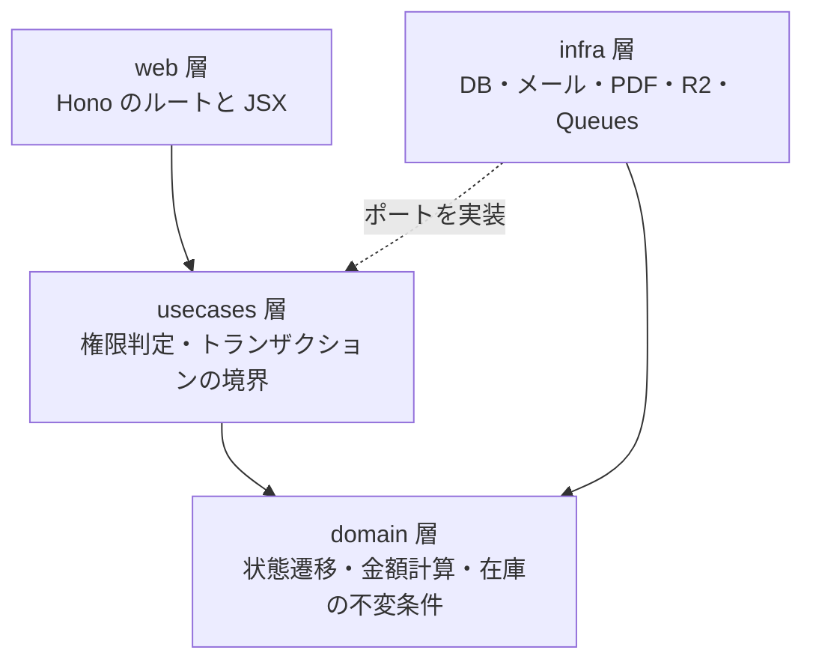

- domain 層は何にも依存しない純粋な関数だけで構成し、入出力（DB、通信、現在時刻の取得）を書かない
- usecases 層は、必要な入出力を「ポート」（インターフェース）として定義し、infra 層がそれを実装する
- web 層は usecases を呼ぶだけで、金額の計算や状態の判定をしない
- この依存の向きは oxlint のルールで強制する（「9. 開発の仕組み」）

### ディレクトリ構成（案）

```text
src/
  domain/        状態遷移、税・金額計算、在庫の不変条件（入出力なし）
  usecases/      「発注する」「発送する」など。権限判定とトランザクションの境界
  infra/
    db/          Drizzle のスキーマ、マイグレーション、リポジトリ
    do/          業務 DB の Durable Object（ユースケースを RPC で公開）
    auth/        Better Auth の設定（D1）
    mail/        メール送信（Email Service と Resend の差し替え口）
    pdf/         Browser Rendering による PDF 化
    storage/     R2
    queue/       ジョブの投入と処理
  web/
    routes/      Hono のルート（画面と部分 HTML）
    views/       JSX テンプレート（画面と帳票）
    paths.ts     URL を生成するヘルパー（hx-post などの文字列を直書きしない）
  worker.ts      エントリーポイント（fetch・queue・scheduled）
tests/
  e2e/           Playwright
```

外部連携の JSON API は、必要になった場合に `src/api/` として追加し、同じ usecases を共有する（現時点では作らない）。

### 状態を変える操作の流れ

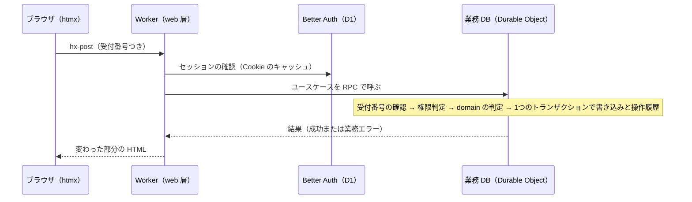

### 各サービスの役割分担

| 対象                                 | 置き場所                 | 理由                                                                                                                                        |
| ------------------------------------ | ------------------------ | ------------------------------------------------------------------------------------------------------------------------------------------- |
| 業務データとユースケースの実行       | Durable Object（SQLite） | 通常のトランザクションが使え、1つのオブジェクトの中は処理が順番に実行されるので、在庫の引当や採番が競合しない。特定時点への復元が30日分ある |
| 社員の役割と有効・無効               | Durable Object           | 権限の判定をユースケースの中で、業務データと同じ場所で行うため                                                                              |
| ログイン情報（ユーザー、セッション） | D1                       | Better Auth が Worker から直接使える。単純な書き込みが中心で、D1 にトランザクションがないことが問題になりにくい                             |
| 帳票 PDF、CSV、バックアップ          | R2                       | 大きなファイルの保存先。バケットロックで保存期間中の削除を防げる                                                                            |
| 重い処理と外部への送信               | Queues                   | 画面を待たせず、失敗したら再試行できる                                                                                                      |

### 実装上の取り決め

- 帳票は画面と同じ Hono の JSX で HTML を作り、Browser Rendering で PDF にする
- 金額・税額の計算は domain 層の1か所に置き、画面の合計表示もその結果を使う
- 業務エラー（在庫不足、状態が違うなど）は例外ではなく、型つきの結果として返し、画面で内容を表示する
- Worker は Web 標準の API と Workers の API だけを使う（Bun 独自の API は使えない）

## 9. 開発の仕組み

型チェック・lint・自動テストを最初から CI の合格条件にし、AI 向けのルールはリポジトリ直下の AGENTS.md にまとめる。前回の不具合（`await` 漏れ、未定義の値を渡した API 呼び出しなど）を、人の注意ではなくツールで防ぐ。

### ツール

| 区分           | 採用                                                                                | ねらい                                                                                                    |
| -------------- | ----------------------------------------------------------------------------------- | --------------------------------------------------------------------------------------------------------- |
| パッケージ管理 | Bun（ツールの実行は Node.js。両方のバージョンを mise で固定）                       | 速いインストール。Wrangler と Vitest は Node.js 前提のため併用する                                        |
| 型チェック     | TypeScript 7。`strict`、`noUncheckedIndexedAccess` など厳格なオプションをすべて有効 | 未定義の値や型の食い違いをコンパイル時に止める                                                            |
| Lint           | oxlint（型情報を使うルールを有効にし、型チェックも同時に実行）                      | `no-floating-promises` などで `await` 漏れを検出する。層の依存ルールは `no-restricted-imports` で強制する |
| 整形           | oxfmt                                                                               | Prettier 互換で高速。問題が出たら Prettier に戻す                                                         |
| 単体テスト     | Vitest + fast-check                                                                 | domain 層の純粋関数と、在庫の不変条件のプロパティベーステスト                                             |
| 結合テスト     | `@cloudflare/vitest-pool-workers`                                                   | Workers の実行環境の上で、Durable Objects・D1・R2 を含めてユースケースを確かめる                          |
| E2E テスト     | Playwright                                                                          | 主要な業務の流れと、タブレットの画面幅                                                                    |
| カバレッジ     | domain 層と usecases 層は行と分岐の90%以上を合格条件にする                          | 業務ルールのテスト漏れを防ぐ                                                                              |
| その他の検査   | knip、秘密情報の混入チェック                                                        | 使われていないコード・依存と、秘密情報のコミットを防ぐ                                                    |
| Git フック     | lefthook                                                                            | コミット時に整形と lint、プッシュ時に型チェックと単体テスト                                               |
| 依存の更新     | Renovate                                                                            | TypeScript と oxlint-tsgolint は同時に更新するグループにする                                              |

### CI と配備

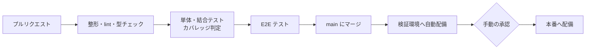

- CI は GitHub Actions。どれか1つでも失敗したらマージできない
- 本番への配備は GitHub の Environments で承認を必須にする
- DB のマイグレーションは Drizzle で生成してコミットし、適用済みのものは書き換えない

### どの変更にどのテストが必要か

| 変更の種類                                 | 必須のテスト                                                       |
| ------------------------------------------ | ------------------------------------------------------------------ |
| 状態遷移・金額計算・在庫のルール（domain） | 単体テスト。在庫に関わるものはプロパティベーステストも             |
| ユースケースの追加・変更（usecases）       | Workers 環境の結合テスト（権限、二重送信、業務エラーの場合を含む） |
| 画面の追加・変更（web）                    | ルートの結合テスト。主要な業務の流れに関わるものは E2E テストも    |
| 帳票のレイアウト                           | テンプレートのスナップショットテストと、インボイスの記載事項の検査 |
| DB のスキーマ                              | マイグレーションの適用テストと、既存の結合テスト                   |

### テストデータ

- 開発用の初期データ投入スクリプトを最初から用意する。保管場所・取引先・商品のマスタと、発注・受注・在庫台帳を実際の業務に近い形（税率の混在、メーカー直、分納、返品、月締め）で作る
- 量は「7. 非機能要件」のとおり本番の約5倍で、乱数の種を固定して毎回同じデータを作る

### AGENTS.md に書く内容

- プロジェクトの概要と、層の構成・依存のルール
- 開発用のコマンドの一覧
- コーディング規約（命名、エラーの扱い、金額は整数、日付と時刻の扱い）
- どの変更にどのテストが必須か（上の表）
- 変更の手順（仕様を確認 → テストを書く → 実装する → すべての検査を通す）
- やってはいけないこと（domain 層に入出力を書かない、画面で金額を計算しない、適用済みのマイグレーションを書き換えない、秘密情報をコミットしない、Bun 独自の API を使わない）
- PR の書き方。CLAUDE.md は AGENTS.md を参照するだけにする

## 10. 未決事項と確認事項

要件はすべて確定済みで、残るのは外部への確認と、初期構築での技術的な検証。

### 社外・社内への確認

- [ ] 電子帳簿保存法：真実性の要件を満たす方法（事務処理規程の要否）を税理士に確認する
- [ ] 帳票のレイアウト：発注書・納品書・請求書・返還請求書のレイアウトを、前回の PDF の雛形をもとに決める
- [ ] 権限表：実際の担当者の兼任状況と照らし合わせる
- [ ] メールの送信元：送信に使う会社のドメインとアドレスを決め、SPF・DKIM・DMARC を設定する
- [ ] Google ログイン：会社の Workspace 組織に属する Google Cloud プロジェクトで、OAuth 同意画面を「内部」に設定する
- [x] 商品の CSV 一括登録（Should）：取り込む項目と形式を決めた（11章の 11.4）
- [ ] ライブレジ（Could）：取込仕様が手に入ったら、商品の CSV 出力を検討する

### 初期構築での技術的な検証

- [ ] Email Service（公開ベータ）：添付つき送信と、検証期間中の1日の送信上限の推移を確かめる。問題があれば Resend に切り替える
- [ ] Better Auth：D1 との組み合わせと、未登録の人にセッションを作らせない設定（ユーザー作成時のフックで社員登録を確認）を検証する
- [ ] TypeScript 7：Hono・Drizzle・Better Auth・Workers の型定義が問題なく使えるか確かめる
- [ ] oxlint：層の依存ルールを `no-restricted-imports` とディレクトリごとの設定で表せるか検証する。表せなければ dependency-cruiser を CI に追加する
- [ ] oxfmt（ベータ）：導入して問題がないか確かめる。問題があれば Prettier に戻す
- [ ] Bun と Vitest：`bun run` から `@cloudflare/vitest-pool-workers` が Node.js で動くことを確かめる
- [ ] Durable Objects：本番の約5倍のテストデータで、集計と一括処理の速度を測る
- [ ] R2 のバケットロック：帳票の保存先に7年の保持ルールを設定し、上書きと削除が拒否されることを確かめる
- [ ] 復元手順：Durable Objects の特定時点への復元と、R2 の日次バックアップからの復元を検証環境で試す

### 参考資料

- [Workers pricing](https://developers.cloudflare.com/workers/platform/pricing/)
- [D1 limits](https://developers.cloudflare.com/d1/platform/limits/)、[D1 data location](https://developers.cloudflare.com/d1/configuration/data-location/)
- [Durable Objects SQL storage API](https://developers.cloudflare.com/durable-objects/api/sql-storage/)、[Durable Objects release notes](https://developers.cloudflare.com/durable-objects/release-notes/)
- [R2 bucket locks](https://developers.cloudflare.com/r2/buckets/bucket-locks/)
- [Email Service pricing](https://developers.cloudflare.com/email-service/platform/pricing/)、[Email Service limits](https://developers.cloudflare.com/email-service/platform/limits/)、[Email Sending public beta](https://developers.cloudflare.com/changelog/post/2026-04-16-email-sending-public-beta/)
- [Browser Rendering pricing](https://developers.cloudflare.com/changelog/post/2025-07-28-br-pricing/)
- [Better Auth: Google](https://better-auth.com/docs/authentication/google)、[Better Auth: Session Management](https://better-auth.com/docs/concepts/session-management)
- [Oxlint: Type-aware linting is stable](https://oxc.rs/blog/2026-07-22-type-aware-linting-stable)、[Oxfmt Beta](https://oxc.rs/blog/2026-02-24-oxfmt-beta)
- [Install/Update Wrangler](https://developers.cloudflare.com/workers/wrangler/install-and-update/)
- [Resend pricing](https://resend.com/pricing)

## 11. 実装で決めた仕様

実装の中で決めた、この要件定義書に書かれていなかった規則です（2026年11月に確認済み）。上の章と食い違うときは、この章が新しい決定です。

### 11.1 仕入

- 仕入先請求書の計算額は、請求日の税率で消費税を足す。送料は入力した額（税込）をそのまま足す。直近の締め期間を初めから選び、支払期限が空なら取引条件から埋める
- 仕入先請求書の状態は「未払い → 一部支払 → 支払済み」と取消。残りの額＝請求額 − 取り消していない支払の合計
  - 支払額は1円以上で残りの額まで。残りより少なければ一部支払、同じなら支払済み。残りが 0 になるまで何回でも支払える
  - 請求額が 0 円以下（返品が仕入を上回る）の請求書は、請求額と同じ額で「精算（相殺・返金）」する
  - 支払の取消は1件ずつで、理由が必須。他の支払が残れば一部支払、残らなければ未払いに戻る
  - 支払（一部を含む）が残っている請求書は取り消せず、その請求書に含まれる入荷・仕入返品も取り消せない（先に支払を取り消す）
  - 一括支払いは、選んだ請求書それぞれの残りを支払う。全件が通るか、何も支払わないかのどちらか（通らない理由を一覧にする）
- 発注の状態は明細から決める：残りの数がある明細があれば発注済み。なければ、受入のある入荷がすべて支払済み（残り 0）の請求書に入っていれば支払済み、そうでなければ入荷済み
  - 支払うものがないとき（受入 0 で打ち切った、すべてその場で返品したなど）は、入荷の完了と同時に支払済みになる
  - 入荷の取消・支払の取消・請求書の取消の後も、同じ決め方で状態を決め直す。支払済みの発注の入荷を取り消すには、先に支払を取り消す
- 入荷の取消は、未払いの請求書に入っていれば請求書から外し、差額が出たら理由を自動で記録する
- 仕入返品は、保管場所に届く発注だけ。返品日は、返品する商品の入荷日より前にできない
- 仕入返品の取消（仕入担当・管理者、理由必須）：支払済み・一部支払の請求書から差し引いた返品は取り消せない。未払いの請求書から差し引いていれば外して計算し直す。在庫は打ち消しの行で戻す
- 支払予定は未払い・一部支払の請求書が対象で、請求額・支払済み・残りを出す。買掛残高は「月ごとの請求額 − 支払額」で、請求書の届いていない入荷は含めない
- 添付した仕入先の請求書は、取引年月日・請求額の範囲・仕入先で検索できる（電子帳簿保存法）
- 発注のメモは、発注書に「備考」として印字する

### 11.2 受注・発送

- 出荷可能数の不足は、保管場所ごとに「引当数の合計が現在庫を超える」商品を含む受注に出す（受注の優先順位は付けない）
- 価格を変えた理由は、保存済みの単価から変えて、かつ今の単価とも違うときだけ必須
- 受注の明細は1商品1行。発送日に未来の日付は使えない
- 分割では、送料は元の受注に残す
- 一括発送は受注番号の順に処理し、在庫が足りない受注は外して続ける
- 発送リストは、選んだ日 × 保管場所で、出荷予定日がその日までの受注済み（メーカー直を除く）をすべて出す。その日より前のものは「遅れ」とし、表の上の要約・販売先の列の見出し・一括発送の表に出荷予定日とともに示す
- 一括発送・印刷（A4 横、【遅れ】の表示つき）・仕分けリストは、発送リストと同じ受注を対象にする。「発送済みの納品書を一括 PDF」は、その日に発送した受注が対象
- ダッシュボードの項目は「今日までの出荷予定（保管場所）」で、遅れの件数を添える
- 日付の順序：発送日は受注日より前、入荷日は発注日より前にできない。一括発送では、受注日が発送日より後の受注を理由とともに示し、外して続けられる
- 納品書の発行日の初期値は、締め日のある販売先なら発送日を含む締め期間の締め日、ない販売先なら当日。個別の発送の画面で変えられる（発送日より前、また今日と初期値の遅いほうより後にはできない）。一括発送は販売先ごとの初期値
- メーカー直の受注は発送リストに出さない。受注詳細から仕入先ごとに発注を作る。届け先は受注の販売先、納品希望日は受注の値、数量は仕入の単位に切り上げる（多くなる数を表示）。受注 × 仕入先で、取り消していない発注は1件まで
- メーカー直の受注の取消・編集・分割では、発注を自動で取り消さない。取り消していない発注があれば「この受注から作った発注が◯件あります（PO-…）。必要なら発注も取り消してください」と発注へのリンクを出す
- 納品書の一括 PDF は閲覧の権限でできる

### 11.3 請求・入金・返品・廃棄

- 請求の方法：締め日のある販売先は締め処理だけ、ない販売先は発送1件につき請求書1枚。締め日のない販売先の支払期限は任意
- 締め処理：
  - 販売先ごとに、まだ請求していない一番古い発送の期間から締める（締め忘れた月が先に出る）。締め日の当日から実行できる
  - 締め日までの未請求の返品は、期間の始めより前のものも含める
  - 画面を開いた後に対象が変わったら、何も発行せず開き直しを求める
  - 1回の締め処理で扱えるのは、販売先 × 期間ごとに発送 2,000件・返品 500件まで（超えたら理由を表示）
  - 1枚の請求書の中の明細は、同じ税率の組でなければならない（期間の途中で税率が変わると締められない）
- 請求書の金額と日付：合計がマイナスの請求書は作れない（返品を外す）。0円の請求書は発行と同時に入金済み。発行日は未来にも、最後の取引より前にもできない
- 取消と再発行は1つの操作。ただ取り消したときは、対象の発送が未請求に戻る
- 消込：請求書の消込済みの額には差額（振込手数料など）も含める。残りより多くは消し込めない。過入金は未消込のまま入金に残り、後で充てられる
- 売掛残高＝未入金の請求額 − 未消込の入金（返還額を含む）。まだ請求していない発送は含めない
- 返還請求書：
  - 請求書に載せた返品の返還請求書は帳票だけで、お金は請求書の中で差し引く。請求書を取り消しても返還請求書は残り、返品は次の請求書に載る
  - どの請求書にも載っていない返品伝票にも発行できる（返品伝票1件につき1枚、経理・管理者）。返還額は元の発送の日の税率で計算し、「相殺」の入金として記録する。返品は以後の請求書に載らない
  - 返還額は後の請求書に消し込める。充てていない残りは「返金済み」にでき、返金は理由をつけて取り消せる。返金できるのは返還額だけ（過入金の返金は対象外）
  - この返還請求書の取消（理由必須）は、返還額を消し込んでも返金してもいないときだけ。取り消すと返品伝票は未請求に戻る
  - 税込1万円未満は「任意」、1万円以上は「必要」と表示するが、発行はいつも手動
- 返品伝票の取消は、請求書に載っておらず、返還請求書もないときだけ。在庫は打ち消しの行で戻す。有効な返品伝票がある発送は取り消せない
- 入金の取消で、その消込もまとめて取り消す。消込の取消も理由が必須。取消によって請求書は入金済み → 一部入金 → 未入金と戻る
- 取消の理由・日時・操作者は、すべての伝票（入金・消込・返品伝票・返金・廃棄伝票を含む）に記録し、伝票の画面に出す
- 販売先廃棄：登録では、その販売先に出荷した商品を表の行として先に出し、ほかの商品は商品選択で足す。廃棄伝票は理由をつけて取り消せ、取り消した伝票は廃棄率の集計に含めない（一覧には「取消」の印つきで残す）

### 11.4 在庫・マスタ・Should の機能

- 商品の CSV 一括登録（`/items/import`、商品の管理の権限）：
  - 列は商品の登録画面と同じ。商品コードが同じ行は、すべての列で上書きする。商品コードが空なら自動で採番する
  - 仕入先とジャンルは名前で指定する。取扱終了と在庫数は CSV に含めない
  - 文字コードは BOM 付き UTF-8・UTF-8・Shift_JIS。1MB・3,000行まで
  - 先に全行を確かめて行ごとの誤りを示し、登録は1つのトランザクションで行う。確かめた後に他の人が変えた商品があれば止める
- 仕入先請求書の添付（PDF だけ、10MB まで）は、差し替えも新しい版として足し、上書き・削除はしない。取消済みの請求書には添付できない。取引年月日・請求額・仕入先で検索できる
- 発送リストと入荷予定一覧のオフライン閲覧は service worker で行う。通信が途切れている間は操作できない。ログアウトで端末から消し、セッションが切れただけのときは次に開くまで残る
- 在庫明細のすべての行に、発生元の伝票の番号とリンクを出す
- 在庫一覧の CSV は、他の一覧と同じく 2,000件を超えると非同期にする（切り捨てない）
- 取引先の取引条件で、当月払いの支払日を締め日より前にはできない（31 は月末として扱う）
- 一度も使っていない商品・取引先は削除できる（版番号を確かめる）。使ったものは取扱終了・取引終了で表す

### 11.5 集計

- 売上＝発送日ごとの発送の明細の金額（税抜、明細ごとに丸める）＋送料 − 返品日ごとの返品伝票。送料は販売先別と月の合計にだけ出す
- 仕入＝入荷日ごとの受入の金額 − 仕入返品。メーカー直も含め、取消済みは除く
- 期間の初期値は直近12か月、最大36か月。全員が見られる。数え方は画面にも書く
- 本番の約5倍のデータで、主な画面は1秒以内。例外は「3年分を商品別」の集計（約1.2秒）で、速くするには月別の集計表が要る（記録はリポジトリの `docs/performance.md`）

### 11.6 運用・セキュリティ

- 配置：Durable Objects はアジア太平洋の中でも日本に近い「北東アジア」（`apac-ne`）、D1 と R2 は「アジア太平洋」（`apac`）を指定する（D1・R2 には北東アジアの指定がない）
- 操作履歴の検索（`/audit-logs`、管理者だけ）：期間・社員・対象の種類・対象（ID、伝票の番号、商品コード）・操作で絞り込み、変更前後の差を示す
- 特定時点への復元（`/admin/restore`、管理者だけ）：失われる操作の件数を示し、戻す時刻を秒まで入力して理由を書いて実行する。本番では、運用担当が Secrets の `RESTORE_UNLOCK_UNTIL` に24時間以内の期限を入れたときだけ動く。復元のやり直しは手順書の手作業で行う
- 受付番号：画面からの操作は、受付番号がないと業務 DB が受け付けない。定期処理・テストデータの投入は内部の操作として分ける
- 開発用ログインとテストデータの投入は、ENVIRONMENT が development / test のときだけ動く。既定の値では動かない
- メールは設定 `MAIL_PROVIDER` で Email Service と Resend を切り替える
- 秘密情報の混入チェック（secretlint）を、コミットのとき・CI で動かす
- デプロイは、Cloudflare の準備が済むまで動かさない（GitHub の変数 `DEPLOY_ENABLED` を `true` にして有効にする）
